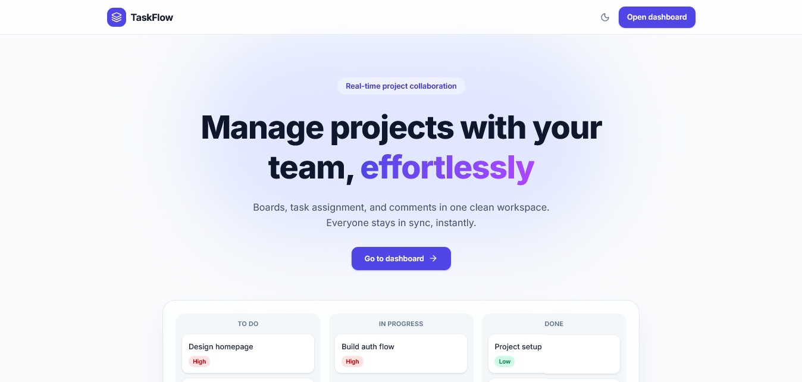
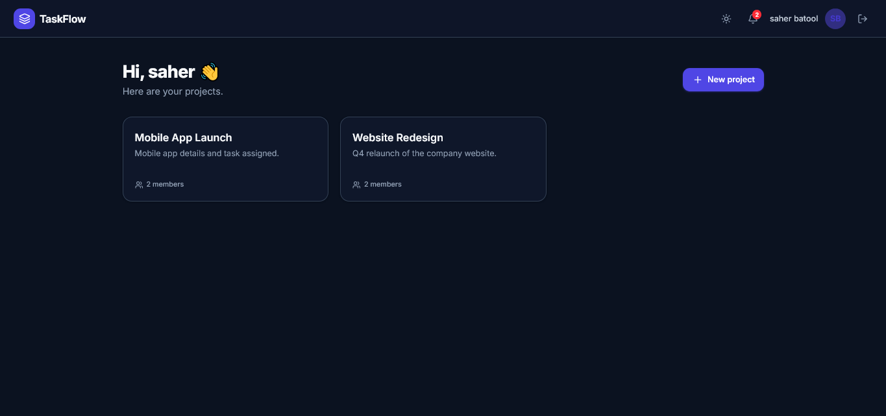
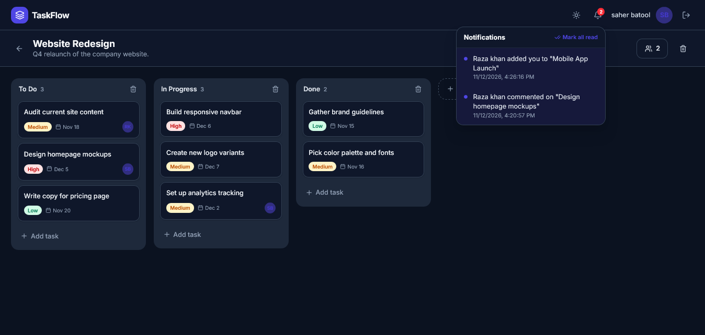
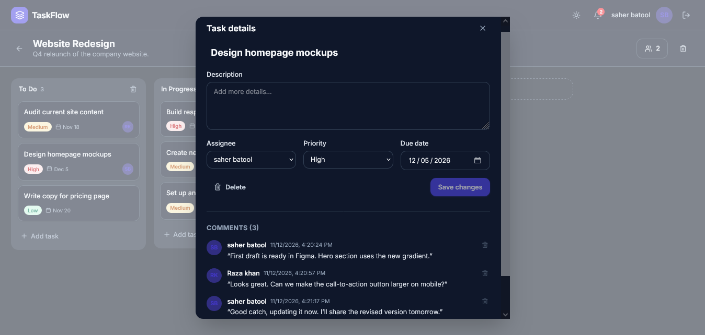

# TaskFlow

A real-time collaborative project management tool (Trello/Asana-style) built with the MERN stack and Socket.io.

**Live demo:** YOUR_VERCEL_URL
**API:** YOUR_RENDER_URL/api/health



## Features

- **Authentication:** register, login, and logout with JWT stored in httpOnly cookies
- **Group projects:** create projects, invite members by email, owner and member roles
- **Kanban boards:** custom columns, drag-and-drop task cards with persistent order
- **Task assignment:** assignee, priority, and due date on every task
- **Comments:** discussion thread inside each task
- **Real-time updates:** boards, comments, and dashboards update live via WebSockets
- **Notifications:** in-app bell with unread badge for assignments, comments, and membership changes
- **UI:** responsive layout, animations, dark mode, loading skeletons, empty states

## Screenshots

| Dashboard | Board (dark) | Task details |
|---|---|---|
|  |  |  |

## Tech Stack

| Layer | Technology |
|---|---|
| Frontend | React (Vite), Tailwind CSS v4, Framer Motion, dnd-kit, React Router |
| Backend | Node.js, Express, Socket.io |
| Database | MongoDB with Mongoose |
| Auth | JWT, bcrypt, httpOnly cookies |

## Getting Started

**Requirements:** Node.js 18+ and a MongoDB database (local or Atlas).

```bash
git clone YOUR_REPO_URL
cd taskflow

# Backend
cd server
npm install
cp .env.example .env     # then fill in the values
npm run dev

# Frontend (new terminal)
cd client
npm install
npm run dev
```

Open http://localhost:5173

### Environment variables

**`server/.env`**

| Variable | Description |
|---|---|
| `PORT` | API port (default 5000) |
| `NODE_ENV` | `development` or `production` |
| `MONGO_URI` | MongoDB connection string |
| `JWT_SECRET` | Long random string used to sign tokens |
| `JWT_EXPIRES_IN` | Token lifetime, e.g. `7d` |
| `CLIENT_URL` | Frontend origin, e.g. `http://localhost:5173` (no trailing slash) |

**`client/.env`**

| Variable | Description |
|---|---|
| `VITE_API_URL` | e.g. `http://localhost:5000/api` |
| `VITE_SOCKET_URL` | e.g. `http://localhost:5000` |

## API Overview

All routes except register and login require authentication.

| Area | Endpoints |
|---|---|
| Auth | `POST /api/auth/register`, `POST /api/auth/login`, `POST /api/auth/logout`, `GET /api/auth/me`, `GET /api/auth/socket-token` |
| Projects | `GET/POST /api/projects`, `GET/PATCH/DELETE /api/projects/:projectId` |
| Members | `POST /api/projects/:projectId/members`, `DELETE /api/projects/:projectId/members/:userId` |
| Board | `GET /api/projects/:projectId/board`, `POST /api/projects/:projectId/columns`, `PATCH/DELETE /api/columns/:id` |
| Tasks | `POST /api/projects/:projectId/tasks`, `GET/PATCH/DELETE /api/tasks/:id`, `PATCH /api/tasks/:id/move` |
| Comments | `GET/POST /api/tasks/:id/comments`, `DELETE /api/comments/:id` |
| Notifications | `GET /api/notifications`, `PATCH /api/notifications/read-all`, `PATCH /api/notifications/:id/read` |

## Real-time Events (Socket.io)

Clients join a room per project (membership is verified on join) and a private room per user.

`task:created`, `task:updated`, `task:deleted`, `comment:created`, `comment:deleted`, `board:refresh`, `notification:new`, `projects:changed`, `member:removed`, `project:deleted`

## Security

- Passwords hashed with bcrypt (cost 12); hashes never leave the server
- JWT in httpOnly, secure, sameSite cookies, so scripts cannot read the token
- **Tiered rate limiting:** a strict limit on failed logins, a stricter one on registration, and a generous one for general API use
- Helmet security headers, CORS restricted to the frontend origin, 10kb body limit
- NoSQL injection protection (key sanitizing plus `isString()` validation), HTTP parameter pollution protection
- Server-side validation on every route with express-validator
- **Access control:** only project members can read or change project data; non-members receive 404 so project existence isn't revealed
- Role checks (owner vs. member) on destructive actions
- Mass-assignment protection: only whitelisted fields can be updated
- Sockets authenticate with a short-lived (2 minute) token and verify membership before joining a project room
- Error responses hide internal details and stack traces in production
- React escapes all user-generated content (comments, titles) to prevent XSS

## Project Structure

```
taskflow/
├── client/          React app
│   └── src/ components, pages, context, lib
└── server/          Express API + Socket.io
    └── src/ controllers, models, routes, middleware, sockets, utils
```

## Known Limitations

- Rate-limit counters are stored in memory, so a multi-instance deployment would need a shared store such as Redis
- Moves and column changes sync by reloading the board rather than patching individual cards
- Members can only be invited if they already have an account
- In production the frontend and API are on different domains, so browsers that block third-party cookies (such as Safari) may fail to keep users logged in. A custom domain shared by both would solve this.

## Author

Sahar-Batool · https://github.com/sahar-batool/CodeAlpha-taskflow